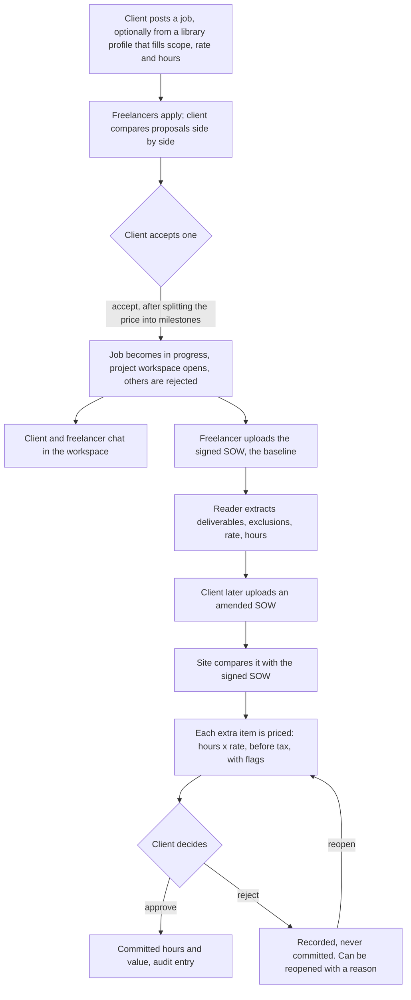
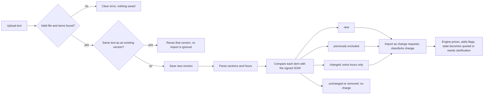
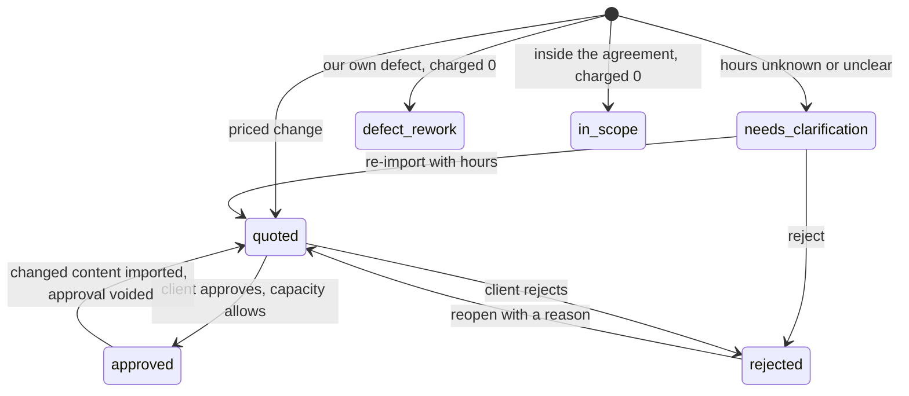
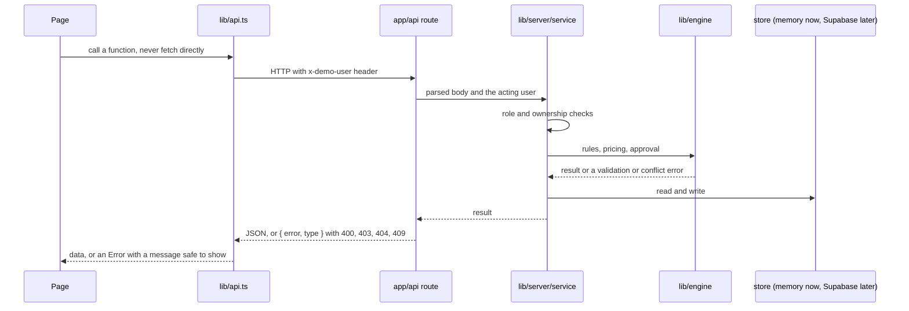
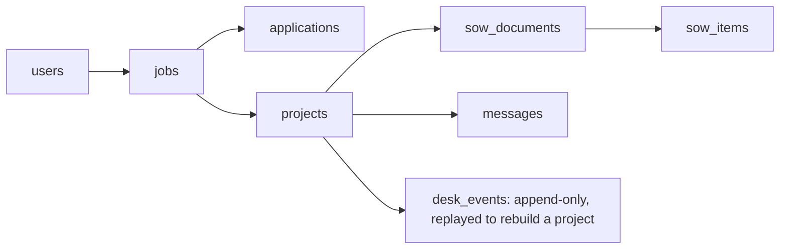
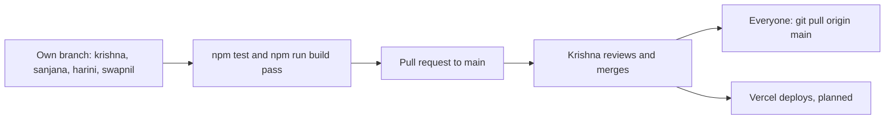
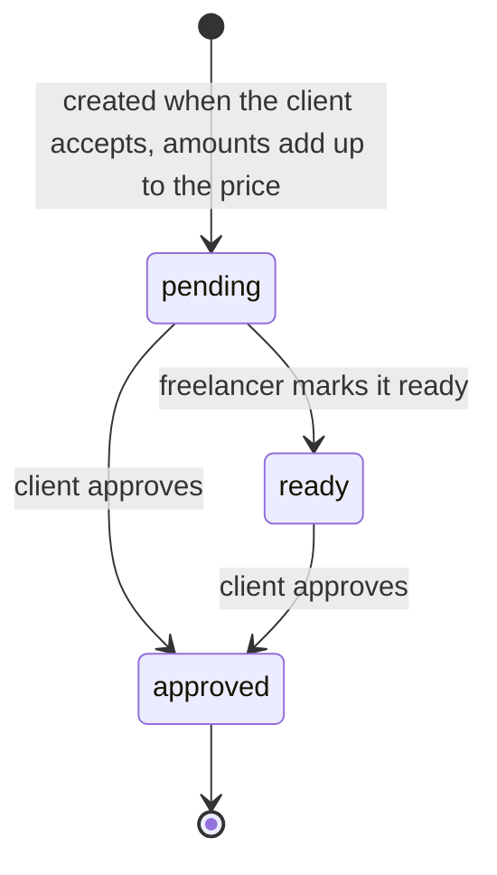

# Flows

How things move through the product and through the team. Diagrams are Mermaid, which GitHub draws automatically. **Owner: Krishna.** Update a flow whenever the behaviour changes, and say so in the pull request.

## 1. The user journey

## 2. How an amended SOW becomes change orders

Rules: unknown hours stay `null` and get no price. A rush request uses the 1.5 multiplier, labelled as an assumption. An item over remaining capacity cannot be approved.

## 3. Change request states

Committed hours = approved + defect rework + in scope. Committed value = approved only.

## 4. A request through the system

## 5. Data layout (planned database)

`desk_events` is the audit trail too. A unique sequence number per project stops two people from booking at once.

## 6. How the team ships

Folders are owned by one person each (`docs/OWNERSHIP.md`). SOW files stay on their authors' branches.

## 7. Layers

| Layer | Where | Who |
| --- | --- | --- |
| Frontend | `app/`, `components/` | Sanjana, Harini, Krishna |
| Backend | `lib/engine`, `lib/server`, `app/api` | Krishna |
| Database | `lib/server/store.ts` today, Supabase planned | Krishna |

## 8. Milestone states

Record only: approving a milestone marks it approved and no money moves.
